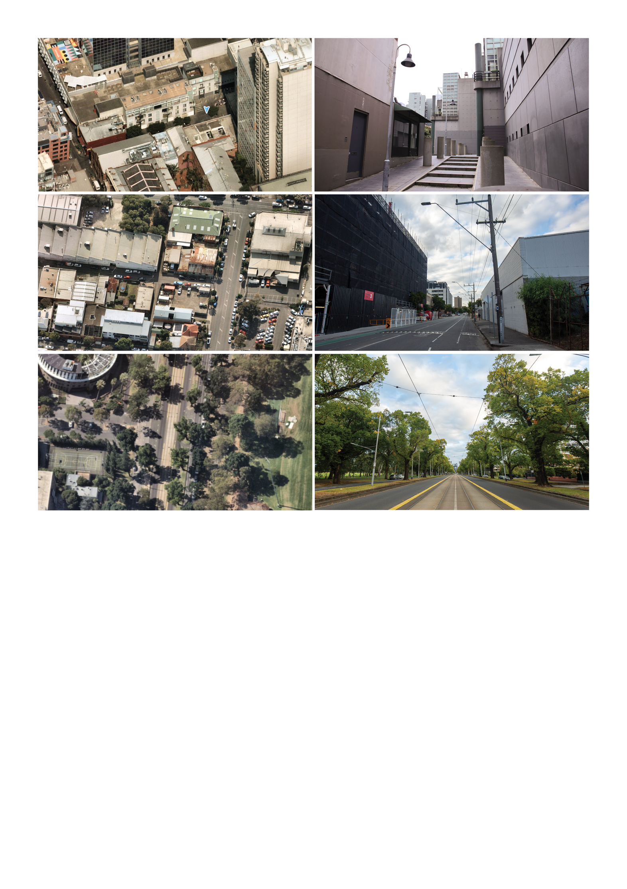
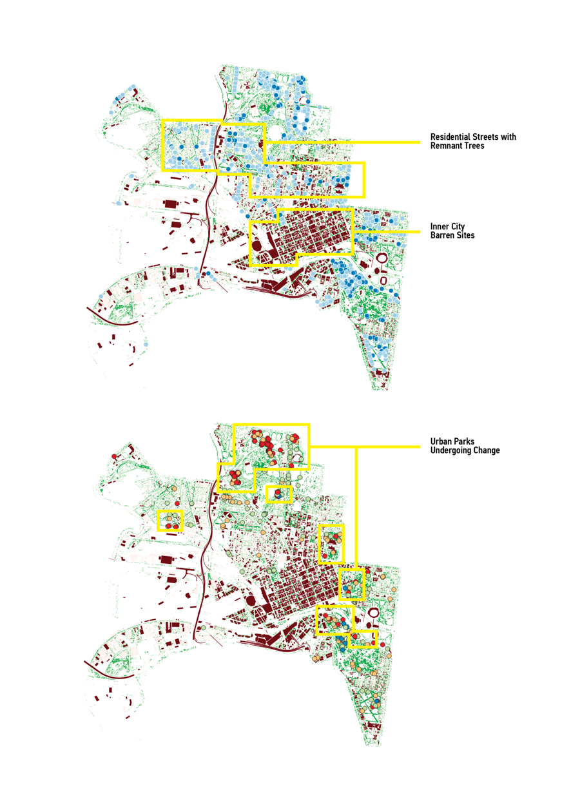
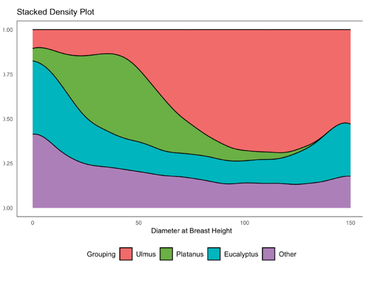

The main text compares human-led and nonhuman-led pathways at three Melbourne places. This appendix describes their locations, model boundaries, pre-colonial settings and relationships to wider urban patterns.

We sample three Melbourne places to compare contrasting starting conditions: buildings dominate City, young native trees characterise Street, and ageing introduced elms structure Parade. Their different constraints connect the research question about nonhuman leadership with spatial opportunities for intervention.

## Places and model boundaries

Figure 1 and Table 1 describe the sampled areas. Each rectangular boundary defines the extent of a [habitat volume](appendix_G_habitat_volumes.qmd). The places represent broader urban conditions while retaining distinct combinations of vegetation, infrastructure and human control.

**Figure 1. Sampled places.** City appears at the top, Street in the middle and Parade at the bottom. The original figure labels Parade as Boulevard. All three are novel ecologies with high degrees of human control. Left images from Nearmap; right images by the authors.

| Place and location | Rectangle boundary coordinates (°S, °E) | Composition and human control | Challenge and opportunity |
|---|---|---|---|
| **City:** Melbourne CBD, within the Hoddle Grid | 37.807625, 144.969310; 37.812841, 144.972270 | Extremely novel; fully managed | Minimal ground space constrains planned greening. Building surfaces offer space for habitat and connections across roofs and façades. |
| **Street:** Carlton and Parkville around the University of Melbourne | 37.785801, 144.957592; 37.791017, 144.960550 | Highly novel; fully managed | Young native street trees lack senescent features. Artificial canopies can provide habitat while trees grow and age. |
| **Parade:** Royal Parade beside Royal Park, Parkville | 37.797253, 144.962603; 37.802469, 144.965563 | Highly novel; highly managed | Senescent introduced elms face removal. Retaining and upgrading their canopies requires space for ageing, branch fall and eventual collapse. |

: **Table 1. Locations, rectangular boundaries and modelling relevance.** Coordinates give the two boundary corners as latitude south and longitude east.

These contrasts shape the [proposals](appendix_I_proposals_and_interventions.qmd) and [pathways](appendix_J_pathway_simulation.qmd) examined by the model: adapting built surfaces at City, supporting a developing canopy at Street, and retaining ageing trees at Parade.

## Pre-colonial baseline context

Before colonisation, inner Melbourne supported a mosaic of grassy woodland, creekline and riparian vegetation, wetlands and saltmarsh. The three places shared an open tree layer above native grasses and herbs, with local differences in substrate and water. The [pre-colonial plant list for the City of Melbourne](https://royalpark.org.au/wp-content/uploads/2023/11/Pre-colonial_plant_list_for_the_City_of_Melbourne.pdf) (Table 2, pp. 9–12) and [Royal Park Master Plan Biodiversity and Ecology Report](https://participate.melbourne.vic.gov.au/download_file/18165/6262) (pp. 9–11) support the regional descriptions below. Exact vegetation boundaries within the sampled rectangles remain spatial inferences.

| Place | Pre-colonial setting |
|---|---|
| **City** | River Red Gum grassy woodland on basalt (EVC 55), interspersed with creekline woodland and grassland, becoming riparian towards the Yarra and estuarine towards present-day Docklands. |
| **Street** | Yellow Box and River Red Gum Valley Grassy Forest (EVC 47) on well-drained sedimentary slopes, with possible creekline vegetation in shallow depressions. |
| **Parade** | Open Yellow Box, Drooping She-oak and River Red Gum grassy woodland (EVC 175 and/or EVC 55), probably grading into Valley Grassy Forest (EVC 47) to the east. |

## Relation to wider urban patterns

Figures 2 and 3 place the sampled conditions within Melbourne's urban forest. They show how barriers, tree size and anticipated removals affect the continuity of habitat beyond each model boundary.

**Figure 2. Places within wider urban conditions.** Yellow callouts relate the three place types to broader patterns. Green shows existing canopy; dark red or brown marks barriers, including buildings over 10 m tall and roads over 15 m wide. The top image locates eucalypts: light blue dots mark potential future large old trees at 50–80 cm diameter at breast height (DBH), and dark blue dots mark historically dominant species over 80 cm DBH. In the bottom image, red and orange dots mark large trees predicted for removal within 10 years.

**Figure 3. Tree genera and trunk sizes across the City of Melbourne.** Urban forest data show that *Ulmus* (red) and *Platanus* dominate the trees with trunk diameters over 80 cm. Trunk size provides a simple proxy for age in this comparison.
