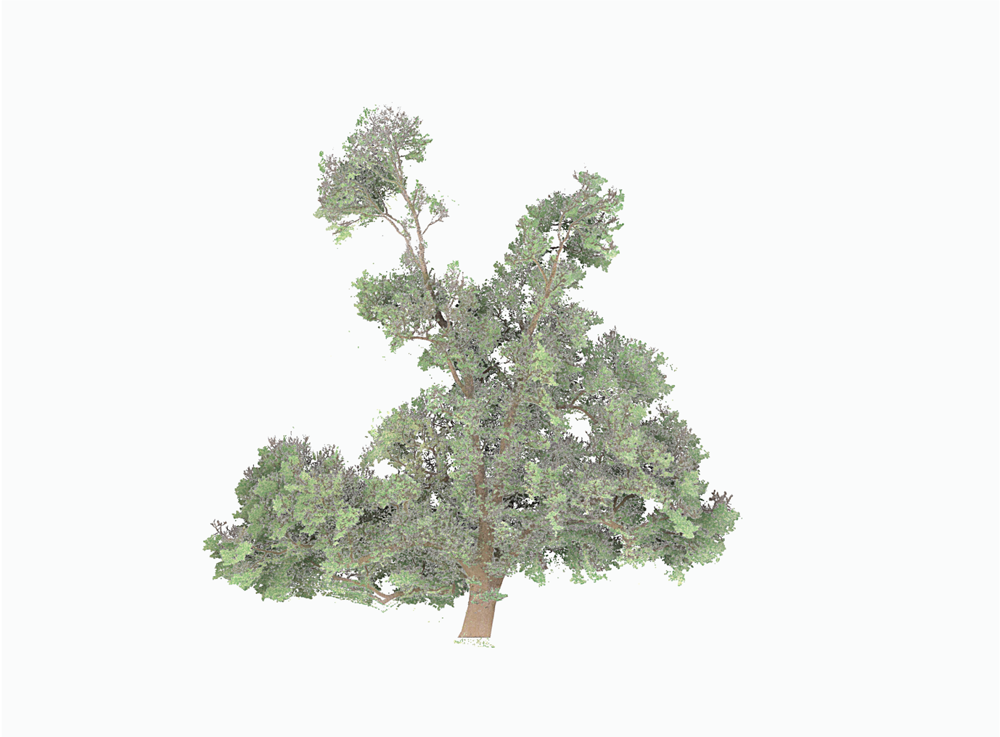
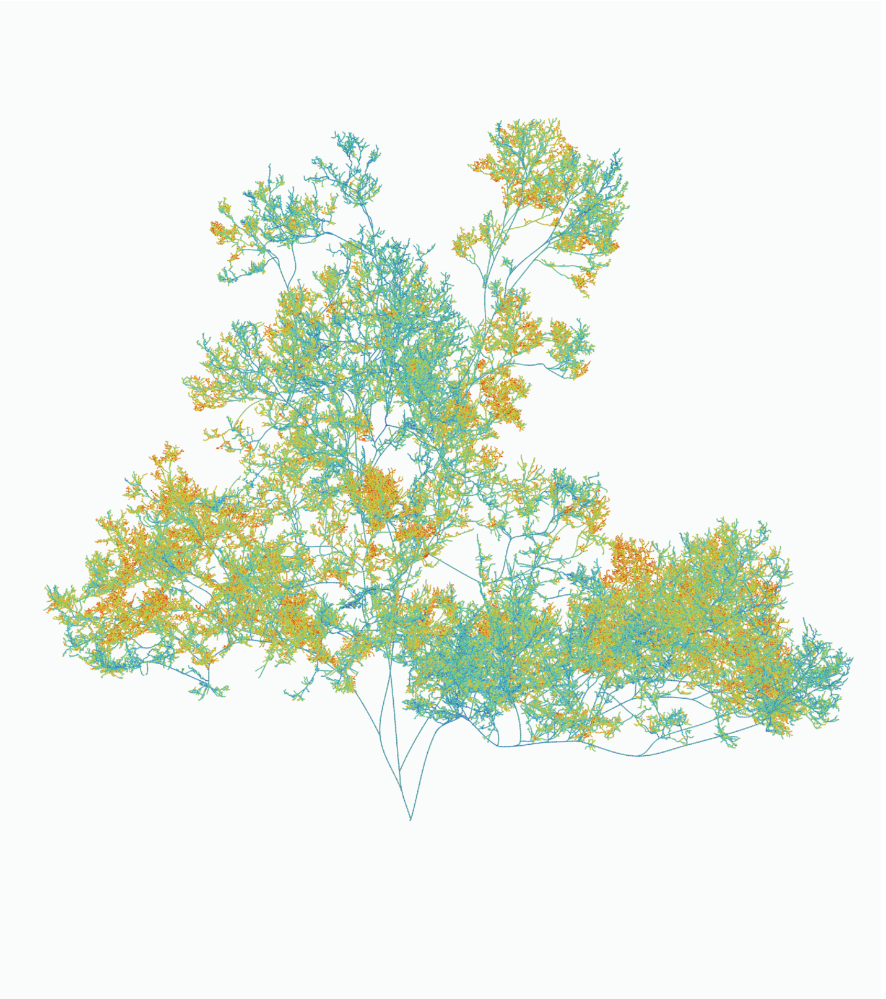
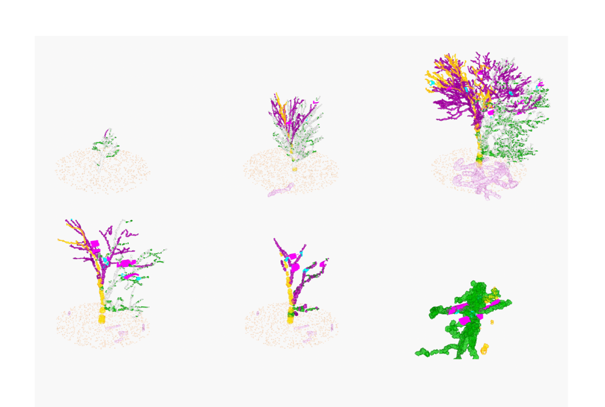

The main text represents habitat opportunities through scan-derived habitat features. This appendix describes the field scans, calibration targets and feature variants used to construct them. [Habitat volumes](appendix_G_habitat_volumes.qmd) explains how the model places these features within each site; [Pathways](appendix_J_pathway_simulation.qmd) describes their subsequent transitions.

## Sampled habitat opportunities

We derived habitat features from field scans of existing trees and modified them to represent four distinct origins.

`Precolonial` derives from scans of 16 *Eucalyptus* trees of species that dominated the open grassy woodlands that used to be widespread in south-eastern Australia[^1] and the northern parts of Melbourne[^2]. These scans capture complex architecture that evolved over centuries without human interference.

`Introduced` derives from scans of 13 ageing *Ulmus*, including some of Melbourne's oldest specimens. These represent introduced trees that now characterise urban forests.

`Hybrid` modifies "pre-colonial" or "introduced" by adding voxel attributes that refer to canopy upgrades such as artificial bark, prosthetic hollows, or planted mistletoe. This variant applies existing guidelines[^3] and emerging approaches explored in our previous work[^4].

`Artificial` modifies Eucalyptus voxel attributes to approximate properties of engineered canopy structures.

Table 1 shows the initial habitat features sorted by origin.

::: {.table-block}

| Scan | Species/Genera | Origin | Trunk size | Landscape context | Source |
|----|----|----|----|----|----|
| U-1 | Ulmus | Introduced | 25 cm | Park | Field scan |
| U-2 | Ulmus | Introduced | 35 cm | Park | Field scan |
| U-3 | Ulmus | Introduced | 18 cm | Park | Field scan |
| U-4 | Ulmus | Introduced | 65 cm | Park | Field scan |
| U-5 | Ulmus | Introduced | 55 cm | Park | Field scan |
| U-6 | Ulmus | Introduced | 72 cm | Park | Field scan |
| U-7 | Ulmus | Introduced | 95 cm | Park | Field scan |
| U-8 | Ulmus | Introduced | 110 cm | Park | Field scan |
| U-9 | Ulmus | Introduced | 88 cm | Park | Field scan |
| U-10 | Ulmus | Introduced | 105 cm | Park | Field scan |
| U-11 | Ulmus | Introduced | 115 cm | Park | Field scan |
| U-12 | Ulmus | Introduced | 92 cm | Park | Field scan |
| U-13 | Ulmus | Introduced | 100 cm | Park | Field scan |
| E-1 | Eucalyptus | Precolonial | 27 cm | Reserve | Field scan |
| E-2 | Eucalyptus | Precolonial | 30 cm | Reserve | Field scan |
| E-3 | Eucalyptus | Precolonial | 41 cm | Pasture | Field scan |
| E-4 | Eucalyptus | Precolonial | 48 cm | Pasture | Field scan |
| E-5 | Eucalyptus | Precolonial | 65 cm | Pasture | Field scan |
| E-6 | Eucalyptus | Precolonial | 65 cm | Urban | Field scan |
| E-7 | Eucalyptus | Precolonial | 66 cm | Reserve | Field scan |
| E-8 | Eucalyptus | Precolonial | 75 cm | Pasture | Field scan |
| E-9 | Eucalyptus | Precolonial | 79 cm | Pasture | Field scan |
| E-10 | Eucalyptus | Precolonial | 113 cm | Reserve | Field scan |
| E-11 | Eucalyptus | Precolonial | 115 cm | Reserve | Field scan |
| E-12 | Eucalyptus | Precolonial | 121 cm | Urban | Field scan |
| E-13 | Eucalyptus | Precolonial | 125 cm | Pasture | Field scan |
| E-14 | Eucalyptus | Precolonial | 130 cm | Reserve | Field scan |
| E-15 | Eucalyptus | Precolonial | 132 cm | Urban | Field scan |
| E-16 | Eucalyptus | Precolonial | 145 cm | Reserve | Field scan |
| H-1 | Eucalyptus | Hybrid | 41 cm | \- | Adapted from scan E-3 |
| H-2 | Eucalyptus | Hybrid | 48 cm | \- | Adapted from scan E-4 |
| H-3 | Eucalyptus | Hybrid | 65 cm | \- | Adapted from scan E-5 |
| H-4 | Eucalyptus | Hybrid | 65 cm | \- | Adapted from scan E-6 |
| H-5 | Eucalyptus | Hybrid | 66 cm | \- | Adapted from scan E-7 |
| H-6 | Eucalyptus | Hybrid | 75 cm | \- | Adapted from scan E-8 |
| H-7 | Eucalyptus | Hybrid | 79 cm | \- | Adapted from scan E-9 |
| H-8 | Eucalyptus | Hybrid | 113 cm | \- | Adapted from scan E-10 |
| H-9 | Eucalyptus | Hybrid | 115 cm | \- | Adapted from scan E-11 |
| H-10 | Eucalyptus | Hybrid | 121 cm | \- | Adapted from scan E-12 |
| H-11 | Eucalyptus | Hybrid | 125 cm | \- | Adapted from scan E-13 |
| H-12 | Eucalyptus | Hybrid | 130 cm | \- | Adapted from scan E-14 |
| H-13 | Eucalyptus | Hybrid | 132 cm | \- | Adapted from scan E-15 |
| H-14 | Eucalyptus | Hybrid | 145 cm | \- | Adapted from scan E-16 |
| H-15 | Ulmus | Hybrid | 95 cm | \- | Adapted from scan U-7 |
| H-16 | Ulmus | Hybrid | 110 cm | \- | Adapted from scan U-8 |
| H-17 | Ulmus | Hybrid | 88 cm | \- | Adapted from scan U-9 |
| H-18 | Ulmus | Hybrid | 105 cm | \- | Adapted from scan U-10 |
| H-19 | Ulmus | Hybrid | 115 cm | \- | Adapted from scan U-11 |
| H-20 | Ulmus | Hybrid | 92 cm | \- | Adapted from scan U-12 |
| H-21 | Ulmus | Hybrid | 100 cm | \- | Adapted from scan U-13 |
| A-1 | \- | Artificial | \- | \- | Adapted from scan E-10 |
| A-2 | \- | Artificial | \- | \- | Adapted from scan E-11 |
| A-3 | \- | Artificial | \- | \- | Adapted from scan E-12 |
| A-4 | \- | Artificial | \- | \- | Adapted from scan E-13 |
| A-5 | \- | Artificial | \- | \- | Adapted from scan E-14 |
| A-6 | \- | Artificial | \- | \- | Adapted from scan E-15 |
| A-7 | \- | Artificial | \- | \- | Adapted from scan E-16 |

: **Table 1. Initial habitat features sorted by origin**

:::

## Calibration

Voxels in habitat features have attributes linked to arboreal resources. We calibrate the amounts so they match observed quantities in tree canopies.

### Rules for eucalyptus habitat features

Field observations of eucalyptus at different ages and sizes across urban, parkland, and woodland contexts provide these data[^5]. Table 2 shows the amounts.

::: {.table-block}

| Lifecycle phase | Management | Peeling Bark (%) | Dead Wood (%) | Fallen Logs (count) | Leaf Litter | Hollows (count) | Epiphytes (count) |
|----|----|----|----|----|----|----|----|
| Sprout | Unmanaged (Reserve) | ~5 | ~10 | ~1 | ~15 | ~1 | ~1 |
| Sprout | Moderated (Park) | ~3 | ~5 | ~0 | ~10 | ~0 | ~0 |
| Sprout | Risk-adverse (Street) | ~0 | ~0 | ~0 | ~0 | ~0 | ~0 |
| Mid-phase | Baseline (Reserve) | ~10 | ~15 | ~2 | ~20 | ~2 | ~2 |
| Mid-phase | Moderated (Park) | ~5 | ~10 | ~1 | ~15 | ~1 | ~1 |
| Mid-phase | Risk-adverse (Street) | ~2 | ~5 | ~0 | ~5 | ~0 | ~0 |
| Large | Baseline (Reserve) | ~15 | ~20 | ~3 | ~25 | ~3 | ~3 |
| Large | Moderated (Park) | ~10 | ~15 | ~2 | ~20 | ~2 | ~2 |
| Large | Risk-adverse (Street) | ~5 | ~10 | ~1 | ~10 | ~1 | ~1 |

: **Table 2. Calibration of arboreal resources in features**

:::

We use these data to estimate resources in other habitat features through the following rules.

### Rules for elm habitat features

We apply the following reductions for resources in “elm” features:

- Apply a large reduction factor (0.05) for most resources

- Apply a smaller factor (0.5) for dead wood and fallen logs, recognising that elm canopies can generate these structures.

### Rules for hybrid and artificial habitat features

Hybrid features derive from eucalyptus and elm scans. Their resource allocation varies with origin, lifecycle stage and degree of human control.

For “large, eucalyptus” habitat features:

- Use the same values as their “unmanaged” variant.

For “medium, eucalyptus” or “large, elm” habitat features:

- 20% of voxels are dead branches

- 5% of voxels are branches with peeling bark

- 2 fallen logs

- 2 hollows

- 2 epiphytes

For “medium, elm” habitat features:

- Dead branch: 20% of voxels are dead branches

- 5% of voxels are branches with peeling bark

- 1 fallen log

- 1 hollow

- 1 epiphyte

For “artificial” features

- Use the same values as the ‘snag’ feature

## Workflow

This section summarises the workflow. It covers extraction of initial structure, cross‑reference with field surveys, temporal cycles, and standardisation.

### Generate initial habitat features

Typical approaches to assessing large old trees struggle to capture their complex structure and describe them in formats that allow comparison[^6]. We address this by representing physical structures as models using a custom scanning workflow[^7]. This workflow uses terrestrial lidar to scan sample trees, creating point clouds that provide detailed canopy descriptions (Figure 1). Feature recognition algorithms separate leaf points from wood.

**Figure 1. Point cloud obtained from a lidar scan of an old elm tree. Green points show points classified as "leaf". Brown indicates points classified as "wood".**

Next, we recognise “branch objects” in scanned trees. We call these recognised structures 'branch objects' to distinguish them from physical branches. We connect branch objects as topological networks and assign structural attributes including radius, length, position, their angles relative to the horizontal plane, and dead/alive states. This process converts raw 3D scan skeletal data into connected branch objects and produces a graph that describes the topology of their connections (Figure 2).

**Figure 2. Initial segmentation of branch objects from scanned tree structure.**

We then sample these connected branch objects as voxels at 0.25m x 0.25m x 0.25m resolution. This provides sufficient detail to link spatial features in tree canopies with persona capabilities. This step transfers all attributes of branch objects into attributes of voxels, including the branch object to which each voxel belongs. This process accounts for external features on branches within trees including perch positions, dead branches, and leaf features but not internal features such as hollows.

We use the topological graph to group branch objects into communities that represent different canopy segments at multiple scales (Figure 3). To achieve this, we apply the Leiden algorithm, a community-detection method that groups together elements with many connections to each other whilst separating those with fewer connections. Applied to our habitat features, this identifies topology-related groups within tree canopies. This hierarchical analysis produces three nested scales of canopy organisation. Canopy group 0 divides the tree into major sections based on where primary branches diverge from the main trunk. Canopy group 1 creates subdivisions within these major sections. Canopy group 2 delineates the smallest scale, identifying features of closely related branch objects.

**Figure 3. Canopy grouping of a large, old elm habitat feature. Canopy group 0 divides voxels into major sections based on where primary branches diverge from the main trunk.**

### Calibrate features

The previous steps produced voxels organised at three levels:

- Voxel-level: individual voxels

- Branch-group level: voxels grouped by branch group

- Canopy-group level: voxels grouped by three canopy groups

We assign field data to voxels using two allocation methods.

- Percentage-based allocation calculates the required number of voxels (as a percentage of total voxels) and selects branch or canopy groups until reaching that target voxel count.

- Count-based allocation assigns a specific number of features, where each feature corresponds to one branch group regardless of its voxel count.

This process assigns dead branches, peeling bark, hollows, epiphytes, perch branches, and fallen logs as attributes of voxels to each habitat feature variant to match the calibration targets specified in the calibration section above. Table 3 shows the selection logic.

::: {.table-block}

| Resource Type | Allocation Method | Resolution | Implementation |
|----|----|----|----|
| Dead Branches | Percentage-based | Canopy-group level | Selects canopy groups (community_ancestors_threshold0) who have proportion of dead branch voxels already closest to target percentage and progressively allocates more voxels within them as dead, supplements with terminal branches if needed |
| Peeling Bark | Percentage-based | Branch-group level | Selects branch groups randomly until reaching target voxel count; weights selection by radius with 2× multiplier for dead branches |
| Hollows | Count-based | Branch-group level | Selects number of branch groups defined by count, filtered by height (\>30% max), radius (\>20% mean), and size (\>10cm radii) thresholds; maintains 2m minimum separation between selections |
| Epiphytes | Count-based | Branch-group level | Selects specified number of branch groups using same filters as hollows; maintains 2m minimum separation between selections |
| Perch Branches | Geometry-based | Branch-group level | Selects terminal branch groups marked as dead with angle \<20° relative to the horizontal plane and radius \<0.15m |
| Fallen Logs | Count-based | New voxels added | Places specified number of pre-generated logs sized by tree size and control type; positions randomly on ground layer within 10m radius with random orientation |

: **Table 3. Allocation rules per resource**

:::

### Simulate temporal changes

Habitat structures develop through temporal cycles that alter their resources. To capture this, we model six lifecycle phases for “pre-colonial” and “introduced” habitat features.

We classify growth phases by trunk diameter at breast height.

Growth phases include "sprout" (trunk diameter \<40cm), "mid-phase" (40-80cm), and "large" (\>80cm) that come directly from scans. We generate decay phases "large, old" (showing dieback), "standing dead" (dead but main trunk standing), and "collapsed" (main trunk on ground) by modifying “large” feature variants and progressively removing voxels to simulate branch loss and collapse (Figure 4).

**Figure 4. Simulated lifecycle stages across sprout, mid-phase, established, senescent, upright snag, and fallen habitat features.**

Below, we describe the steps to create the “decay” phases.

*Create “senescent” variants.*

1.  Start with “large” habitat feature voxels

2.  Select 1-3 canopy group 0 segments randomly and mark all contained voxels as dead

3.  Prune small outer branches on dead segments that fall below radius threshold (0.05m)

4.  Apply resource allocation using senescent-specific targets

*Create standing snag feature variants:*

1.  Start with senescent features

2.  Remove all branches below radius threshold (0.05m)

3.  Retain trunk and major branches exceeding radius threshold

4.  Reset all resource attributes and apply snag targets:

    - Mark all remaining voxels as dead

    - Mark terminal branches as perch

*Create “fallen” feature variants.*

1.  Start with “*standing snag*” feature variant

2.  Convert canopy group 0 groupings into individual meshes.

3.  Align longest edge of mesh with ground plane

4.  Place meshes at ground level (Z = 0)

5.  Re-voxelise meshes to create new point clouds

6.  Group fallen branches using DBSCAN clustering algorithm

7.  Count voxels within each group to classify as small branches, medium branches, or whole trees

8.  Apply resource allocation using fallen-specific targets

Trunk diameter at breast height provides the basis for sorting scanned features into Sprout, Mid-phase and Large growth phases.[^5] Decay phases also use age-related transition probabilities. Table 4 records the properties used in this feature-construction account; [Pathways](appendix_J_pathway_simulation.qmd) specifies the simulation's lifecycle rules.

::: {.table-block}

| Origin | Lifecycle phase | Value |
| --- | --- | --- |
| Precolonial, Introduced | Sprout | <40cm trunk diameter |
| Precolonial, Introduced | Mid-phase | 40-80cm trunk diameter |
| Precolonial, Introduced | Large | >80cm trunk diameter |
| Precolonial | Large, Old |  |
| Introduced | Large, Old | ‘Useful life expectancy’ from Melbourne Urban Forest Data[^8] or 138.55 years of age as an onset of senescence.;  ;  We follow the same approach outlined by Croesser[^9] who use allometric equations provided by the US Forestry Database[^10] and treat the maximum age of these equations as maximum age is treated as the point of "likely senescence. We use the allometric equation for *Ulmus americana* in the Pacific Northwest, USA, a related species of Elm and a similar climate to Melbourne. |
| Introduced | Standing snag | Species-specific lifespan rule remains to be confirmed. |
| Introduced | Fallen | Snags approaching +50 year threshold increase chance of transitioning to “fallen” as per Le Roux’s observation that snags can stand for at least 50 years[^11] |

: **Table 4. Life cycle phase definitions**

:::

### Standardise features for comparison

Every habitat feature model exists in two versions used for different purposes. The fine version uses voxels with sides of 0.25m to generate images. The indicator version uses voxels with sides of 1m to calculate metrics.

We convert from fine to indicator resolution as follows: if any small voxel (0.25m) within a larger voxel (1m) contains a specific attribute, we assign that attribute with a value of 1 to the larger voxel. This approach smooths out small variations between scans and supports comparison between different structures.

## References

[^1]: Department of Environment, Climate Change and Water NSW. (2011). National Recovery Plan for White Box—Yellow Box—Blakely’s Red Gum Grassy Woodland and Derived Native Grassland: A Critically Endangered Ecological Community. Sydney, Department of Environment, Climate Change and Water New South Wales.

[^2]: Graeme S. Lorimer. (2011). Melbourne's Plant Life: Past and Present. Victorian Naturalist 128(5), 175-182.

[^3]: Karen Ikin, Darren S. Le Roux, Laura Rayner, Nelida R. Villaseñor, Kathy Eyles, Philip Gibbons, Adrian D. Manning, and David B. Lindenmayer. (2015). Key lessons for achieving biodiversity‐sensitive cities and towns. Ecological management & restoration 16(3), 206–214. https://doi.org/10.1111/emr.12180

[^4]: Dan Parker, Stanislav Roudavski, Therésa M. Jones, Nick Bradsworth, Bronwyn Isaac, Martin T. Lockett, and Kylie Soanes. (2022). A framework for computer-aided design and manufacturing of habitat structures for cavity-dependent animals. Methods in Ecology and Evolution 13(4), 826-841. https://doi.org/10/gpggfj

[^5]: Darren S. Le Roux, Karen Ikin, David B. Lindenmayer, Adrian D. Manning, and Philip Gibbons. (2018). The value of scattered trees for wildlife: contrasting effects of landscape context and tree size. Diversity and Distributions 24(1), 69-81. https://doi.org/10.1111/ddi.12658

[^6]: Alexander Holland, Philip Gibbons, Jason Thompson, and Stanislav Roudavski. (2023). Modelling and design of habitat features: will manufactured poles replace living trees as perch sites for birds?. Sustainability 15(9), 7588. https://doi.org/10/gr7jqf

[^7]: Alexander Holland, Philip Gibbons, Jason Thompson, and Stanislav Roudavski. (2023). Modelling and design of habitat features: will manufactured poles replace living trees as perch sites for birds?. Sustainability 15(9), 7588. https://doi.org/10/gr7jqf; Alexander Holland, Philip Gibbons, Jason Thompson, and Stanislav Roudavski. (2024). Terrestrial lidar reveals new information about habitats provided by large old trees. Biological Conservation 292, 110507. https://doi.org/10/gtmt9p

[^8]: City of Melbourne. (2016). Urban Forest Visual.

[^9]: Thami Croeser, Wolfgang W. Weisser, Joe Hurley, Thomas Rötzer, Leila Parhizgar, Qian Sun, and Sarah A. Bekessy. (2025). Defining ‘adequate’ tree protection: meeting urban canopy targets requires careful retention of mature trees. Landscape and Urban Planning 264, 105484. https://doi.org/10/g97cvc

[^10]: E. Gregory McPherson, Natalie S. Van Doorn, and Paula J. Peper. (2016). Urban tree database and allometric equations. Albany, CA, U.S. Department of Agriculture, Forest Service, Pacific Southwest Research Station. https://doi.org/10.2737/PSW-GTR-253

[^11]: Darren S. Le Roux, Karen Ikin, David B. Lindenmayer, Adrian D. Manning, and Philip Gibbons. (2014). The future of large old trees in urban landscapes. PLOS ONE 9(6), e99403. https://doi.org/10.1371/journal.pone.0099403
