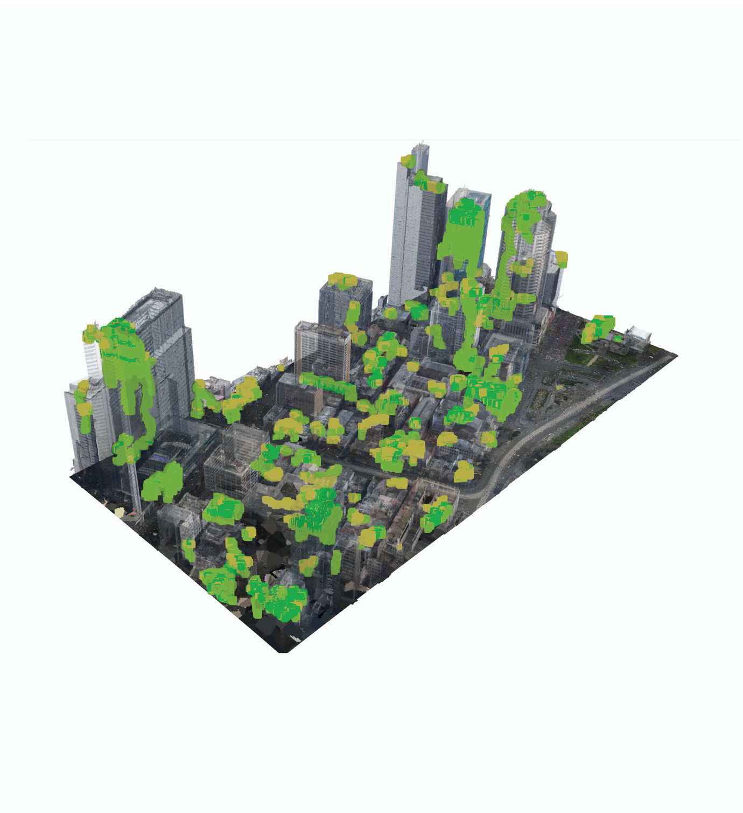

The main text uses resistance to represent the relative difficulty of changing a location. This appendix describes the spatial parameters and connectivity workflow that prepare resistance inputs for the [pathway simulation](appendix_J_pathway_simulation.qmd), where effort thresholds determine which interventions can proceed.

## Resistance parameters

Table 1 records the parameterisation of the resistance grid. It retains the source's signed values and unresolved entries, marked [?]. The relationship between these signed scores and the glossary's 0–100 resistance scale remains to be confirmed.

| **Category** | **Urban feature** | **Resistance value** |
|----|----|----|
| ***Roadways*** | Major arterial road | -100 |
|  | Other road carriageway | -80 |
|  | Laneway / little road | -50 |
| ***Adaptable vehicle infrastructure*** | On-street parking | 100 |
|  | +3 m parking buffer | 50 |
|  | Road medians | 50 |
| ***Pedestrian infrastructure*** | Footpaths | \[?\] |
|  | Tramways | \[?\] |
| ***Existing depaving plans*** | Laneway regeneration plans | 80-100 |
| ***Building envelopes*** | Heavy load rooftops | 30-75 |
|  | Light-load rooftops | 20-60 |
|  | Façade | As per roof |
| ***Adaptable urban infrastructure*** | Utility poles | \[?\] |
| ***Existing green space*** | Public open space | 80 |
|  | Existing tree canopies | +30 |
|  | Unassigned areas | 60 |

: **Table 1. Resistance parameterisation**

## Connectivity resistance

Patches describe where bioavailable portions of the habitat volume could extend from existing habitat features to improve connectivity. A spatially explicit simulation of grassland patch growth uses the resistance field to account for variation across the landscape. It applies cellular automata mechanics to the habitat volume, drawing on an approach used to model plant-community dynamics in changing ecosystems[^1]. Figure 1 illustrates the resulting connections.

**Figure 1.** Simulated biofaçades at the City site connect green and brown rooftops to the ground.

For each site, the connectivity simulation:

1.  Identifies starting nodes based on trees, logs, and poles

2.  Precomputes neighbour relationships between voxels

3.  Runs the expansion algorithm from each node

4.  Assigns voxel attributes based on the result

Table 2 shows how the expansion algorithm operates from each node.

::: {.table-block}

| Step | Action | Details |
| --- | --- | --- |
| 1 | Set starting energy by node type and size | Large trees: 2500 energy units; Medium trees: 2000 energy units; Small trees: 1000 energy unit; Large logs: 750 energy units; Medium logs: 500 energy units; Small logs: 250 energy units; Utility poles: 125 energy units |
| 2 | Set start nodes | Set starting nodes where patches grow to neighbouring voxels |
| 3 | Assign energy cost | Urban elements create resistance that costs energy:; Low resistance areas (<50): No energy loss, fast expansion; Medium resistance areas (50-80): Moderate energy loss, occasional termination; High resistance areas (>80): Significant energy loss, high termination probability |
| 4 | Grow patches | Each expansion step increments the turn counter; Voxels expanding have a chance to terminate (stopping their growth) and split (growing into two regions).; Voxels growing on façades have a weighting to grow downwards to link starting nodes on roofs with the ground.; Maximum turns set to 5000 (representing long-term potential); The turn value for each voxel indicates how quickly it can be rewilded |
| 5 | Assign voxel attributes | Based on the results, assign the following attributes to voxels:; sim_Nodes: Groups voxels into patches; Sim_Turns: Record how many turns it took to reach the voxel |

: **Table 2. Steps for generating patches**

:::

## References

[^1]: Guillaume Decocq, Philippe Regnault, Jonathan Lenoir, Frédéric Paccaut, Laurent Menza, Gauthier Delvoye, Elise Janvresse, Déborah Closset-Kopp, and Olivier Goubet. (2023). Modelling plant community dynamics in changing forest ecosystems: a review. Botany Letters 170(4), 541-564. https://doi.org/10.1080/23818107.2023.2231045
